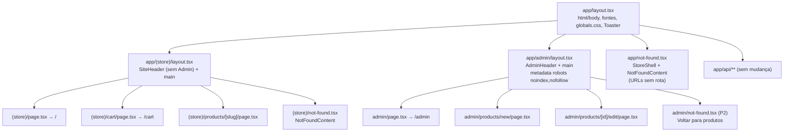

# Área de Admin Separada — Design

**Spec**: `.specs/features/admin-area/spec.md`
**Status**: Implemented

---

## Research (docs locais do Next 16)

Fonte: `apps/web/node_modules/next/dist/docs/01-app/03-api-reference/`.

| Tema | O que os docs dizem | Consequência aqui |
| --- | --- | --- |
| Route groups (`03-file-conventions/route-groups.md`) | Pasta `(nome)` organiza rotas **sem entrar na URL**. Serve para "opting specific route segments into sharing a layout, while keeping others out". Grupos diferentes não podem resolver para a mesma URL. | `app/(store)/` agrupa loja sem mudar `/`, `/cart`, `/products/[slug]` (ADMA-06). |
| Múltiplos root layouts (`layout.md` › Root Layout; `route-groups.md` › Caveats) | Dá para ter vários root layouts (sem `app/layout.tsx`), mas navegar entre eles causa **full page load**, e o 404 global fica difícil (precisa de `global-not-found.js`, experimental). | **Não usar.** Mantemos um root layout único e mínimo, e cada área tem um layout aninhado. |
| `not-found.js` (`03-file-conventions/not-found.md`) | Renderiza quando `notFound()` é lançado no segmento. O `app/not-found.tsx` raiz também cobre URLs que não batem com nenhuma rota. O Next injeta `<meta name="robots" content="noindex">` no 404. | O 404 raiz renderiza **só dentro do root layout**, então precisa montar o shell da loja ele mesmo (ADMA-03). |
| Metadata `robots` (`04-functions/generate-metadata.md` › robots, › Merging) | `robots: { index: false, follow: false }` gera `<meta name="robots" content="noindex, nofollow">`. Campos aninhados são **sobrescritos** pelo último segmento que os define. | Definir `robots` só em `app/admin/layout.tsx`. As páginas do admin **não** podem definir `robots`. |
| `LayoutProps` (`layout.md`) | Helper global tipado por rota, ex.: `LayoutProps<'/dashboard'>`. | `LayoutProps<"/admin">` no layout do admin. Para o grupo `(store)` o tipo exato não está documentado; usar `{ children: React.ReactNode }` (ver Tech Decisions). |

---

## Architecture Overview

Um único root layout (`<html>`, `<body>`, fontes, `globals.css`, `Toaster`) e dois layouts aninhados: o da loja (grupo `(store)`, sem efeito na URL) e o do admin (segmento real `admin`).



### Estrutura de pastas

**Antes**

```
apps/web/app/
├── layout.tsx              # html/body + SiteHeader (com "Admin") + main + Toaster
├── not-found.tsx
├── page.tsx                # /
├── cart/page.tsx           # /cart
├── products/[slug]/page.tsx
├── admin/
│   ├── page.tsx
│   └── products/
│       ├── new/page.tsx
│       └── [id]/edit/page.tsx
└── api/...
```

**Depois**

```
apps/web/app/
├── layout.tsx              # MODIFICADO: só html/body, fontes, globals.css, Toaster
├── not-found.tsx           # MODIFICADO: <StoreShell><NotFoundContent/></StoreShell>
├── (store)/
│   ├── layout.tsx          # NOVO: <StoreShell>{children}</StoreShell>
│   ├── not-found.tsx       # NOVO: <NotFoundContent/> (notFound() lançado na loja)
│   ├── page.tsx            # MOVIDO de app/page.tsx
│   ├── cart/page.tsx       # MOVIDO de app/cart/page.tsx
│   └── products/[slug]/page.tsx  # MOVIDO de app/products/[slug]/page.tsx
├── admin/
│   ├── layout.tsx          # NOVO: AdminHeader + main, metadata (robots + title)
│   ├── not-found.tsx       # NOVO (P2): 404 com "Voltar para produtos"
│   ├── page.tsx            # sem mudança
│   └── products/...        # sem mudança
└── api/...                 # sem mudança

apps/web/components/
├── site-header.tsx         # MODIFICADO: remove o botão "Admin"
├── store-shell.tsx         # NOVO: SiteHeader + <main> da loja
├── not-found-content.tsx   # NOVO: o Empty "Página não encontrada" (extraído de app/not-found.tsx)
└── admin/
    ├── admin-header.tsx    # NOVO
    ├── product-form.tsx    # sem mudança
    └── delete-product-button.tsx  # sem mudança
```

Mover arquivos é seguro: todos os imports usam o alias `@/…` (nenhum import relativo em `app/`), e o único import relativo, `./globals.css`, fica em `app/layout.tsx`, que não sai do lugar.

---

## Code Reuse Analysis

### Existing Components to Leverage

| Component | Location | How to Use |
| --- | --- | --- |
| `SiteHeader` | `components/site-header.tsx` | Mantido; só perde o `<Link href="/admin">`. |
| Estrutura do header (sticky, `max-w-6xl`, marca com `CpuIcon`) | `components/site-header.tsx` | Copiar o padrão visual no `AdminHeader` para manter a identidade. |
| `Button`, `Badge` | `components/ui/` | Nav e selo "Admin" no `AdminHeader`. |
| `Empty*` | `components/ui/empty.tsx` | `NotFoundContent` e o 404 do admin. |
| `Toaster` | `components/ui/sonner.tsx` | Continua no root layout, então serve as duas áreas (ADMA-09). |
| Páginas do admin e `ProductForm` | `app/admin/**`, `components/admin/**` | Sem mudança: `router.push("/admin")` e o link "Cancelar" já apontam para `/admin`. |

### Integration Points

| System | Integration Method |
| --- | --- |
| Typed routes (`PageProps<"/products/[slug]">`, `PageProps<"/admin/products/[id]/edit">`) | Route groups não mudam o path, então os tipos continuam válidos depois do `next typegen`/`dev`. |
| Carrinho (Zustand `persist`, `einfo-cart`) | Sem mudança. Como o root layout é único, a navegação loja ↔ admin continua client-side, e o store fica no localStorage de qualquer jeito. |
| `lib/queries.ts` (`await connection()` + `<Suspense>`) | Sem mudança. Os layouts novos não fazem leitura de dados, então não criam problema de prerender com `cacheComponents`. |

---

## Components

### Root layout (`app/layout.tsx`, modificado)

- **Purpose**: Shell HTML compartilhado pelas duas áreas.
- **Interfaces**: `export const metadata` (title/description da loja, como hoje); `RootLayout({ children }: LayoutProps<"/">)`.
- **Contém**: `<html lang="pt-BR">` com as variáveis de fonte, `<body className="flex min-h-full flex-col">`, `{children}`, `<Toaster richColors position="bottom-right" />`.
- **Remove**: `SiteHeader` e `<main>` (vão para o `StoreShell`).

### `StoreShell` (`components/store-shell.tsx`, novo)

- **Purpose**: Chrome da loja (header público + `<main>`), reusado pelo layout `(store)` e pelo 404 raiz.
- **Interfaces**: `StoreShell({ children }: { children: React.ReactNode })` → `<><SiteHeader /><main className="mx-auto w-full max-w-6xl flex-1 px-4 py-8">{children}</main></>`.
- **Reuses**: o markup atual do root layout, sem mudança.

### Store layout (`app/(store)/layout.tsx`, novo)

- **Purpose**: Aplicar o `StoreShell` a todas as rotas da loja.
- **Interfaces**: `StoreLayout({ children }: { children: React.ReactNode })` → `<StoreShell>{children}</StoreShell>`. Sem `metadata` própria (herda do root).

### `NotFoundContent` (`components/not-found-content.tsx`, novo)

- **Purpose**: O bloco `Empty` "Página não encontrada" + "Ir para o catálogo", extraído sem mudança de `app/not-found.tsx`.
- **Usado por**: `app/not-found.tsx` (dentro do `StoreShell`) e `app/(store)/not-found.tsx` (puro, já que o layout da loja envolve).

> **Incerteza a verificar na T9:** os docs locais não dizem com todas as letras se um `notFound()` lançado em `(store)/products/[slug]` é capturado pelo `not-found.tsx` do grupo `(store)` (renderizado **dentro** do layout da loja) ou se sobe até o `app/not-found.tsx` (renderizado só dentro do root layout). O design cobre os dois caminhos: nos dois casos aparece exatamente um `SiteHeader`. O critério de aceite é visual: um header, nunca dois, nunca nenhum. Registrar o comportamento observado em STATE.md › Lessons.

### `AdminHeader` (`components/admin/admin-header.tsx`, novo)

- **Purpose**: Header da área de admin.
- **Interfaces**: `AdminHeader()` (Server Component, sem props).
- **Conteúdo**: marca (`CpuIcon` + "einfo.tech") linkando para `/admin` + `<Badge variant="secondary">Admin</Badge>`; nav com `Button variant="ghost"`: "Produtos" → `/admin`, "Novo produto" → `/admin/products/new`, "Ver loja" → `/` (ícone `StoreIcon` ou `ExternalLinkIcon`). **Sem** `CartBadge`.
- **Estado ativo do link**: fora de escopo (exigiria Client Component com `usePathname`); dá para adicionar depois.
- **Reuses**: classes do `SiteHeader` (`sticky top-0 z-40 border-b bg-background/85 backdrop-blur`, container `max-w-6xl h-16`).

### Admin layout (`app/admin/layout.tsx`, novo)

- **Purpose**: Layout e metadata de todas as rotas `/admin/**`.
- **Interfaces**:
  ```ts
  export const metadata: Metadata = {
    title: "Admin — einfo.tech",
    robots: { index: false, follow: false },
  };
  export default function AdminLayout({ children }: LayoutProps<"/admin">) {
    return (<><AdminHeader /><main className="mx-auto w-full max-w-6xl flex-1 px-4 py-8">{children}</main></>);
  }
  ```
- **Regra**: as páginas do admin continuam definindo só `title`. Nenhuma pode definir `robots`, porque isso sobrescreveria o do layout (merge raso de campos aninhados).

### Admin not-found (`app/admin/not-found.tsx`, novo, P2)

- **Purpose**: 404 dentro do layout do admin para `notFound()` em `/admin/products/[id]/edit`.
- **Conteúdo**: `Empty` "Produto não encontrado" + `Button` "Voltar para produtos" → `/admin`.

---

## Error Handling Strategy

| Error Scenario | Handling | User Impact |
| --- | --- | --- |
| `/products/<slug-inexistente>` | `notFound()` → `(store)/not-found.tsx` (ou raiz) | 404 com header da loja, sem link de admin |
| URL sem rota (`/foo`, `/admin/xyz`) | `app/not-found.tsx` com `StoreShell` | 404 da loja; nada revela o admin |
| `/admin/products/<id-inexistente>/edit` | `notFound()` → `admin/not-found.tsx` | 404 com header do admin e volta para `/admin` |
| Erro de API no form | Sem mudança (toast via `Toaster` do root) | Igual a hoje |

---

## Tech Decisions

| Decision | Choice | Rationale |
| --- | --- | --- |
| Root layout único vs. múltiplos root layouts | Único root layout + layouts aninhados | Evita o full page reload entre áreas e o `global-not-found` experimental. O `Toaster` e as fontes ficam num só lugar. |
| Grupo para o admin? | Não. `app/admin/` já é um segmento real e recebe o próprio `layout.tsx`. | `(admin)/admin/…` seria redundante. Só a loja precisa de grupo, para tirar o header público da raiz. |
| Onde fica o `<main>` | Em cada layout de área (`StoreShell`, `AdminLayout`) | Cada área controla largura e padding. Hoje são iguais (`max-w-6xl`). |
| Tipagem do layout `(store)` | `{ children: React.ReactNode }` | Não achei nos docs locais qual chave de `LayoutProps` vale para um layout de route group. Tipagem explícita evita adivinhar. Se `LayoutProps<"/">` passar no `tsc`, pode usar. |
| `noindex` | `metadata.robots` no `admin/layout.tsx`; sem `robots.txt` | Um `robots.txt` com `Disallow: /admin` anunciaria o caminho. O meta só aparece para quem já está na página. |
| Header `X-Robots-Tag` via `next.config` `headers()` | Não | O meta basta para um app local. Fica como opção se o M2 publicar o app. |
| Link "Ver loja" no admin | Sim | O pedido proíbe só o sentido loja → admin. Voltar para a loja é útil para o operador conferir mudanças (ADM-08). |
| Proteção real | Nenhuma nesta feature (R-01) | A autenticação está no M2. Um `proxy.ts` com Basic Auth seria proteção pela metade, sem modelo de usuário. |
