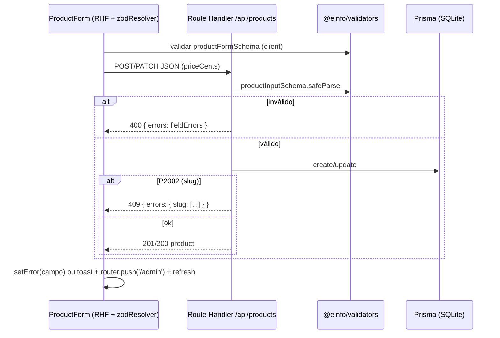

# Admin de Produtos — Design

## Fluxo

## Schemas (`packages/validators`)

- `productInputSchema` — contrato da API: `name`, `slug`, `description`, `priceCents` (int > 0), `stock` (int ≥ 0), `categoryId`, `imageUrl` (url opcional / null).
- `productUpdateSchema = productInputSchema.partial()`.
- `productFormSchema` — contrato do formulário: igual ao input, mas `price` como string em BRL; `parseBRL()` converte para centavos.
- `productQuerySchema` — `q`, `category`, `ids` para `GET /api/products`.

## Componentes

| Arquivo | Responsabilidade |
| --- | --- |
| `apps/web/app/admin/page.tsx` | RSC: busca produtos e renderiza `ProductsTable` |
| `apps/web/components/admin/products-table.tsx` | Tabela shadcn + `DeleteProductButton` |
| `apps/web/components/admin/delete-product-button.tsx` | Dialog de confirmação → `DELETE` |
| `apps/web/components/admin/product-form.tsx` | Form RHF (create/edit), auto-slug, mapeamento 400/409 |
| `apps/web/lib/api-utils.ts` | Helpers de resposta (`badRequest`, `notFound`, `conflict`) e detecção P2002 |
